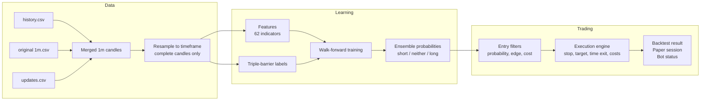
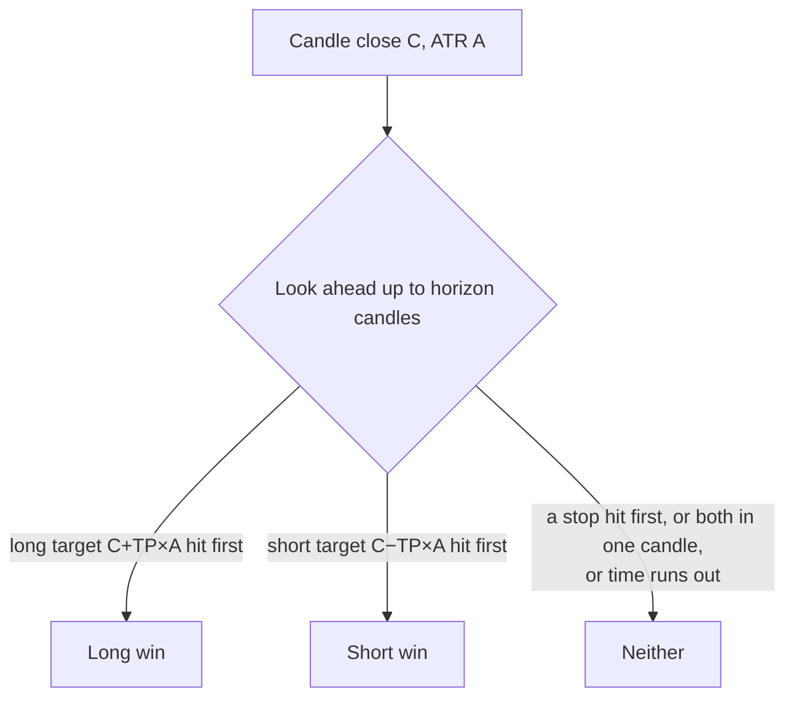
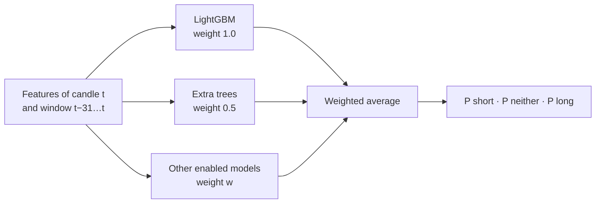
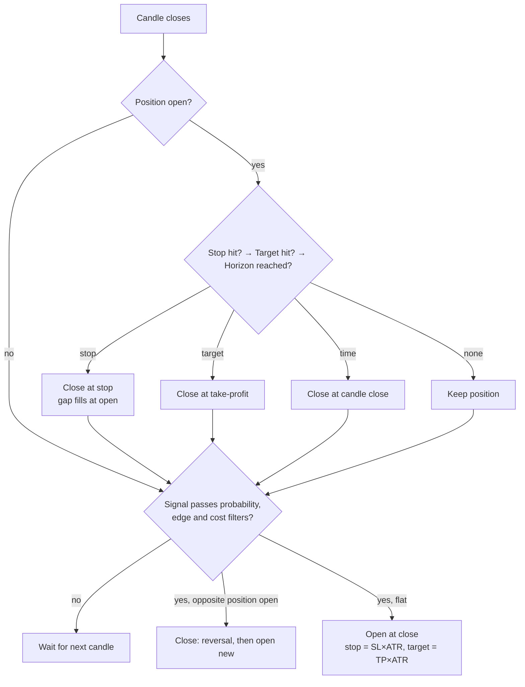
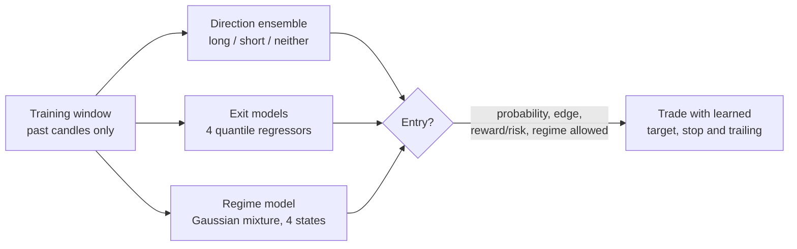
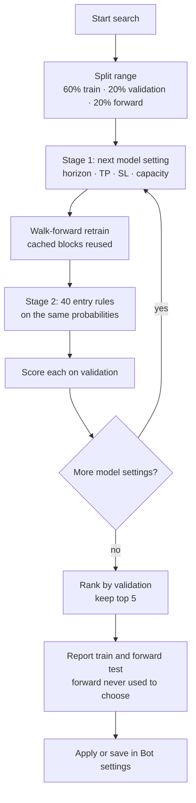
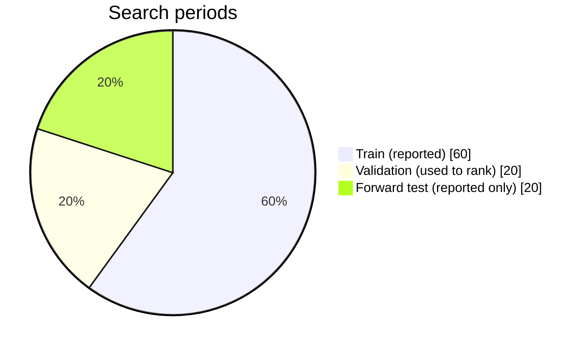
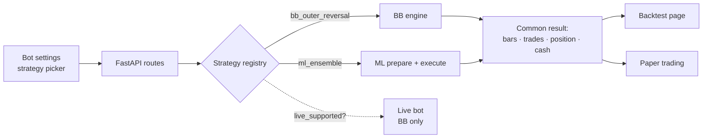
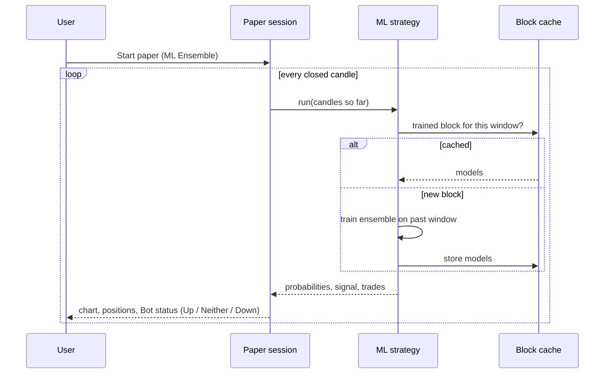

# ML Ensemble Strategy — How It Is Implemented

This document explains how the **ML Ensemble** strategy works in Silver Terminal:
what data it uses, how the models are trained and tested, how signals become
trades, how hyperparameter search works, and how it plugs into backtests and
paper trading. It describes the code as it is in `server/strategies/ml/`.

---

## 1. Big picture



Text version:

```
1-minute OKX candles (CSV + history + updates)
        │  resample to the chosen timeframe (5m, 15m, 1h, …)
        ▼
Indicator features (62 columns, past data only)          features.py
        │
Triple-barrier labels (long win / short win / neither)   labels.py
        │
Walk-forward training: train on the past, predict the     walk_forward.py
next unseen block, repeat (models cached per block)
        │  ensemble of models → probabilities per candle
        ▼
Signals: probability, edge and cost filters               strategy.py
        │
Execution engine: entry at close, ATR stop / target,      execution.py
time exit, reversal, fees + spread + slippage + funding
        │
Backtest result / paper session / Bot status              registry.py
```

The strategy is a **3-class classifier**. For every closed candle it estimates:

| Class | Meaning |
|---|---|
| **Long win** | A long opened at this close would reach its take-profit before its stop |
| **Short win** | A short opened at this close would reach its take-profit before its stop |
| **Neither** | Neither side wins within the horizon (time-out or both stops) |

It trades only when the model is confident one side wins, and only if the
expected profit is large enough to pay trading costs.

---

## 2. Data

* Source: public OKX `XAG-USDT-SWAP` 1-minute candles.
* Three local files are merged (newer rows win on overlap):
  1. `OKX_XAG-USDT-SWAP_1m_history.csv` — older candles downloaded with **Data details → Older history** (back to the contract listing, 28 Jan 2026).
  2. `OKX_XAG-USDT-SWAP_1m.csv` — the original file (never modified).
  3. `OKX_XAG-USDT-SWAP_1m_updates.csv` — new candles added hourly.
* Minutes are resampled to the execution timeframe. A candle is used only when
  **all of its minutes exist** and it has **fully closed**; incomplete candles
  are left empty so they can never leak into training or signals.

---

## 3. Features (indicators) — `features.py`

Features are organised in **groups**. Each group is a function
`candles → table of columns` that uses **only the current and earlier candles**,
so a feature value never depends on the future. Values are scale-free (returns,
ratios, z-scores), so the model is not confused by the price level.

| Group | Columns (examples) |
|---|---|
| **Returns** | log return over 1, 2, 3, 6, 12, 24, 48, 96 candles |
| **Volatility** | ATR % of price, ATR 14 vs 56, realised volatility 12/48, Parkinson volatility, range % |
| **Bollinger bands** | position in band, band width and z-score for 20 and 50 periods, width change |
| **Trend** | distance from EMA 9/21/50/100, EMA slopes, MACD and histogram, ADX, DI spread, efficiency ratio |
| **Oscillators** | RSI 7/14/28, stochastic %K/%D, Williams %R, CCI, rate of change |
| **Volume** | volume z-score, volume ratio, OBV slope, MFI, distance from rolling VWAP |
| **Candle shape** | body ratio, upper/lower wick, close position in range, up-candle count, gap |
| **Time of day** | hour and weekday as sine/cosine cycles |
| **Higher timeframe** | slower trend: 24-candle return, distance and slope of a 4× longer SMA, RSI 56 |

Total: **62 features** with all groups enabled. You can switch groups on and off
in **Bot settings → Indicators**.

A test checks the no-look-ahead rule: features computed on the first 400 candles
are identical to the first 400 rows computed on 600 candles.

---

## 4. Labels — `labels.py` (triple-barrier method)

For each candle with close `C` and ATR `A`:

* **Long** barriers: take-profit `C + TP × A`, stop `C − SL × A`.
* **Short** barriers: take-profit `C − TP × A`, stop `C + SL × A`.
* Look forward up to `horizon` candles using highs and lows.



Rules:

* The barrier touched **first** decides the outcome.
* If one candle touches **both** barriers, it counts as a **loss** (stop first) —
  the same conservative rule the execution engine uses.
* The last `horizon` candles have no label yet (their future is unknown).

Because labels use the *same* TP, SL and horizon that trades use, the model learns
exactly the outcome the strategy trades on.

Defaults: horizon 12 candles, TP 1.5 × ATR, SL 1.0 × ATR, ATR length 14.

---

## 5. Models — `models.py` and `sequence.py`

All models sit in a **registry**. Each one is trained through the same interface
and returns probabilities in the fixed order **(short, neither, long)**, so any
mix can be averaged.

| Model | Family | Input | Notes |
|---|---|---|---|
| **LightGBM** | Gradient boosting | features of one candle | Default main model; fast and strong on tabular indicators |
| **XGBoost** | Gradient boosting | features of one candle | Different regularisation; good second booster |
| **Histogram GBM** | Gradient boosting | features of one candle | scikit-learn, no extra install |
| **Random forest** | Bagged trees | features of one candle | Stable, hard to overfit |
| **Extra trees** | Bagged trees | features of one candle | Default partner model; adds diversity |
| **Logistic regression** | Linear | scaled features | Simple baseline |
| **Neural network (MLP)** | Deep learning | scaled features | Two hidden layers, early stopping |
| **1D-CNN** | Deep learning (PyTorch) | last 32 candles of features | Dilated convolutions find short patterns |
| **LSTM** | Deep learning (PyTorch) | last 32 candles of features | Recurrent network for longer dependencies |

Details shared by all models:

* **Class balance:** classes are weighted so the model is not biased towards
  the most frequent outcome.
* **Missing values:** boosting models handle them natively; the others use a
  median imputer (and scaling where needed).
* **Sequence models:** each sample is the window of the 32 feature rows ending
  at the predicted candle. Windows may look *back* before the training range but
  never forward. Features are standardised with training statistics only.
  Training uses AdamW, class-weighted cross-entropy, gradient clipping and early
  stopping on the last 15% of the training window (in time order). A test checks
  that changing later candles does not change a CNN prediction.
* **Model capacity** — `light`, `standard`, `rich` — sets each model's size
  (number of trees, tree depth / leaves, minimum leaf size, network width). It
  is a setting and a search axis.

### Ensemble



The selected models vote with their **weights** (0–1 sliders in the UI). The
ensemble probability is the weighted average of the models' probabilities.
Default: **LightGBM (1.0) + Extra trees (0.5)**, chosen as the best balance of
speed and accuracy in testing.

---

## 6. Walk-forward training — `walk_forward.py`

The core rule: **a model only ever predicts candles it has never seen, and its
training labels never use those candles.**

```
time ──────────────────────────────────────────────────────────►
|◄──── training window (train_bars) ────►| gap |◄ test block ►|
                                          ^     ^
                                horizon candles  predicted by this model
```



```mermaid
gantt
    title Walk-forward blocks (example: train 6000, retrain every 2000 candles)
    dateFormat X
    axisFormat %s
    section Block 1
    Train          :t1, 0, 6000
    Gap (horizon)  :g1, 6000, 6012
    Predict        :crit, p1, 6012, 8012
    section Block 2
    Train          :t2, 2000, 8000
    Gap (horizon)  :g2, 8000, 8012
    Predict        :crit, p2, 8012, 10012
    section Block 3
    Train          :t3, 4000, 10000
    Gap (horizon)  :g3, 10000, 10012
    Predict        :crit, p3, 10012, 12012
```

1. The evaluated range is cut into consecutive **test blocks** of
   `retrain_every` candles (default 2000).
2. For each block, a new ensemble is trained on the `train_bars` labelled candles
   (default 6000) that end **`horizon` candles before** the block. The gap
   guarantees that no training label looks into the block.
3. The ensemble predicts every candle of the block.
4. The next block repeats with the window moved forward.

Every probability in a backtest is therefore **out-of-sample**.

### Caching

Each trained block is stored in an in-memory cache keyed by the exact training
window and the model settings. Re-running the same settings, extending the date
range, or a paper session receiving new candles only trains **new** blocks.
Block boundaries are anchored at the start date so cached blocks stay valid.

Typical timing (15m candles, default models): first run 10–20 s, repeat run ~5 s.

---

## 7. From probabilities to trades — `strategy.py` and `execution.py`

### Entry filters (all must pass)

| Filter | Default | Meaning |
|---|---|---|
| **Entry probability** | 0.55 | P(long win) or P(short win) must reach this |
| **Edge over opposite side** | 0.15 | P(long) − P(short) (or the reverse) must reach this |
| **Reward ÷ cost** | 3× | TP distance must be ≥ 3 × the round-trip cost (2 × slippage + spread + 2 × fee) |
| **Direction** | Both | Long only / short only / both |

The cost filter matters most on short timeframes: on 5m silver the typical TP
is about the same size as the round-trip cost, so most signals are skipped.



### Execution rules (shared engine, identical to the BB strategy's rules)

* Entries fill at the **completed candle close**, worsened by slippage + half the spread.
* Each trade gets a **stop** at `SL × ATR` and a **take-profit** at `TP × ATR`.
* Stops and targets are checked with the next candles' open/high/low; a gap
  through a level fills at the worse open price; a candle touching both is a stop.
* A trade still open after `horizon` candles closes at the close (**time exit**).
* An opposite confident signal can **reverse** the position (setting).
* Fees on both sides and **prorated funding** are charged.
* Position size = amount per trade (% of balance or fixed $) × leverage.

The engine returns the same result format as the BB engine, so charts, trade
tables, summary cards and paper trading work unchanged.

---

## 7b. What the models learn besides direction — `exits.py`

Every walk-forward block trains three things on the same past-only window:



| Learned | Target the model learns | Used for |
|---|---|---|
| **Direction** | triple-barrier label | long / short / no trade |
| **Long / short MFE** | largest favourable move within the horizon (× ATR), quantile *q_tp* (default 0.4) | take-profit distance |
| **Long / short MAE** | largest adverse move within the horizon (× ATR), quantile *q_sl* (default 0.7) | stop distance and trailing distance |
| **Market regime** | 4 clusters on 24-candle return, 48-candle volatility, efficiency, ADX, EMA slope | name the state; trade only in chosen states |

* A **lower target quantile** gives a closer take-profit that is reached more often; a **higher stop
  quantile** gives a stop outside normal noise.
* Learned distances are clipped to 0.3–6 × ATR. Blocks without an exit model fall back to the fixed
  ATR multiples.
* **Learned reward/risk filter:** an entry needs learned target ÷ learned stop ≥ *min reward/risk*
  (default 1.2).
* **Trailing stop:** activates after `trail_start` × learned target (default 60%) and follows the
  best price by `trail_noise` × learned stop; it never loosens.
* **Regimes:** clusters are named from their centres — highest volatility = *Volatile*, strongest
  positive trend = *Trend up*, strongest negative = *Trend down*, the rest = *Range*. The Model tab
  shows time spent, trades, win rate and P&L per regime; Bot settings → *Market regimes* chooses
  which states may trade.

Real data check (15m, last 120 days, default settings): learned targets ≈ 1.3 × ATR and stops ≈
2.4 × ATR — silver usually moved further against a trade than for it within 12 candles, so the
reward/risk filter skipped about 1 100 weak signals. Per regime, only **Range** was profitable
(7 trades, +$28); trend and volatile states lost. This is the kind of insight the grid search
(regimes, quantiles, trailing start, minimum reward/risk) can now be pointed at.

### What the grid search tunes in learned mode

| Stage | Axes |
|---|---|
| Model (retrains) | horizon 8/12/24 × target quantile 0.3/0.4/0.5 × stop quantile 0.6/0.75, then capacity check |
| Entry (no retraining) | entry probability × edge × minimum reward/risk 1.0/1.3/1.6 × trailing start 0.5/0.8 |

---

## 8. Hyperparameter search — `tuning.py`

Started from **Bot settings → Find better settings** (with ML Ensemble selected).

### Two stages

| Stage | What changes | Cost | Grid search | Random search |
|---|---|---|---|---|
| **1. Model** | horizon, TP × ATR, SL × ATR, capacity | retrains all blocks | 3 × 3 × 2 = 18 settings, then the 2 best retested at the other capacities | 24 random settings from wider ranges (incl. capacity) |
| **2. Entry** | entry probability, edge, reverse on signal | re-runs execution only | 5 × 4 × 2 = 40 rules per model setting | same |

Stage 2 reuses the probabilities from stage 1, so 40 entry rules cost about as
much as one model run.





### Honest selection

* The range is split **60% train / 20% validation / 20% forward test**.
* All three periods use out-of-sample walk-forward predictions.
* Candidates are **ranked on validation only** (objective: profit, or a balanced
  score of win rate, profit, drawdown and average loss; fewer than 20 trades is
  discounted).
* The **forward test is reported, never used to choose**. It shows whether a
  setting still works on data the search could not tune for.

Example on the real data (15m, last 120 days): 880 combinations in 389 s; the
best validation case made +$7 but lost $39 in the forward test — the search
found no robust edge in this period.

The result has the same structure as the BB tuner, so the UI shows the top 5
cases, their train/validation/forward metrics, and **Apply** / **Save** buttons.

---

## 9. Where it runs

| Place | Supported | How |
|---|---|---|
| **Backtest** | Yes | Results page with summary cards and a **Model** tab |
| **Paper trading** | Yes | Same engine on live or replayed candles; Bot status shows Up / Neither / Down probabilities |
| **Live trading** | No (by design) | Blocked until the strategy proves itself in paper trading |

The **strategy registry** (`server/strategies/registry.py`) is the single place
that connects a strategy to backtests, paper trading, charts and the live guard.





### Model tab (backtest results)

* Out-of-sample accuracy vs. random guessing (33.3%).
* Accuracy per test block.
* Outcome balance (long win / neither / short win).
* Cost vs. target and number of signals skipped for cost.
* Top 15 indicators by tree-model importance.

---

## 10. Settings reference

| Setting | Default | Where |
|---|---|---|
| Indicator groups | all 9 | Step 2 |
| Models and weights | LightGBM 1.0, Extra trees 0.5 | Step 3 |
| Model capacity | standard | ML settings / search |
| Horizon | 12 candles | Step 4 |
| Take profit / stop | 1.5 / 1.0 × ATR | Step 4 |
| ATR length | 14 | Step 4 |
| Entry probability | 0.55 | Step 4 |
| Edge over opposite | 0.15 | Step 4 |
| Reward ÷ cost | 3× | Step 4 |
| Reverse on signal | on | Step 4 |
| Training window | 6000 candles | Step 5 |
| Retrain every | 2000 candles | Step 5 |
| Amount, leverage, direction | 100%, 1×, both | Step 1 |
| Fees, slippage, spread, funding | HTX defaults | Step 6 |

---

## 11. Code map

| File | Responsibility |
|---|---|
| `server/strategies/ml/features.py` | Indicator feature groups (registry) |
| `server/strategies/ml/labels.py` | Triple-barrier labels and MFE/MAE excursion targets |
| `server/strategies/ml/exits.py` | Learned exit (quantile) models and market regime model |
| `server/strategies/ml/models.py` | Model registry, capacity presets, unified `fit_model` |
| `server/strategies/ml/sequence.py` | PyTorch 1D-CNN and LSTM |
| `server/strategies/ml/walk_forward.py` | Walk-forward training and block cache |
| `server/strategies/ml/strategy.py` | `MLSettings`, prepare / execute, signals, bot status |
| `server/strategies/ml/tuning.py` | Grid and random hyperparameter search |
| `server/strategies/execution.py` | Shared signal execution engine |
| `server/strategies/registry.py` | Connects strategies to backtest, paper and live |
| `server/tests/test_ml_strategy.py` | Look-ahead, labels, execution, models, walk-forward and tuning tests |
| `src/features/strategy/MLStrategySettings.tsx` | ML settings UI |
| `src/features/research/ModelReportPanel.tsx` | Model tab UI |

### Extending

* **New indicator:** write one function returning columns and add a `FeatureGroup`.
* **New model:** add a builder and a `ModelSpec` (set `sequence` for window models).
* **New strategy:** implement a `StrategyRunner` and register it.

---

## 12. Limits to keep in mind

* **One instrument, about 9½ months of data.** OKX history for this contract
  starts on 28 Jan 2026. More data or related markets (gold, dollar index)
  would improve reliability more than a more complex model.
* **Accuracy slightly above random is normal** for price data; it does not mean
  the strategy is profitable after costs.
* **Costs dominate on short timeframes.** Prefer 15m or higher.
* Not modelled: liquidation, partial fills, order-book depth, funding history.
* Search results can overfit. Trust a setting only if the forward test and a
  later paper-trading period also hold up.
